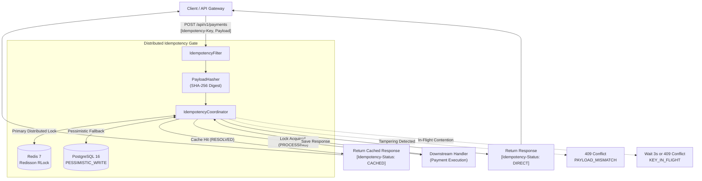

# DeltaFlow

> **Distributed Idempotency & Saga Orchestrator for Financial APIs**

[](https://openjdk.org/)
[](https://spring.io/projects/spring-boot)
[](https://www.postgresql.org/)
[](https://redis.io/)
[](LICENSE)

DeltaFlow is a high-consistency coordination proxy and transactional saga orchestrator engineered to guarantee **exactly-once execution** for distributed payment processing and financial transfers.

---

## The Problem

Distributed financial systems and microservice architectures frequently encounter partial failures:
- **Duplicate Debits**: A payment request times out over the network while the debit succeeds remotely. An impatient client or automated gateway retries, double-charging the customer.
- **Payload Tampering / Key Collision**: A client reuses an `Idempotency-Key` but alters the payload (e.g. changing the transaction amount or recipient account).
- **In-Flight Contention**: Rapid concurrent requests with the identical idempotency key arrive within milliseconds, creating race conditions across worker nodes.
- **Stranded States & Zombie Steps**: Worker processes crash mid-transaction, leaving distributed locks permanently orphaned.

Full-fledged orchestration platforms (Temporal, Camunda) introduce proprietary DSLs, steep learning curves, and operational overhead. DeltaFlow provides a lightweight, database-backed idempotency proxy and state machine tailored specifically for financial consistency.

---

## Core Architecture



### Key Architectural Capabilities

1. **Dual-Stage Lifecycle Locking**:
   State transitions follow a strict 4-state lifecycle: `PENDING` $\rightarrow$ `PROCESSING` $\rightarrow$ `RESOLVED` / `FAILED`.
2. **Cryptographic Payload Tampering Protection**:
   Incoming request bodies are hashed into SHA-256 digests. If an existing key is presented with a mismatched body, DeltaFlow immediately rejects it with `HTTP 409 Conflict (IDEMPOTENCY_KEY_PAYLOAD_MISMATCH)` without calling downstream services.
3. **Tiered Distributed Locking**:
   - **Primary**: Redis distributed locking with sub-millisecond acquisition and Redis Pub/Sub transition notifications.
   - **Failover**: Automatic fallback to PostgreSQL row-level pessimistic locking (`PESSIMISTIC_WRITE` / `SELECT ... FOR UPDATE`).
4. **Lease Auto-Expiration & Recovery**:
   Active locks carry a configurable lease TTL (default: 30 seconds). If an orchestrator instance crashes, subsequent retries reclaim the expired lease, preventing deadlocks.
5. **Java 21 Sealed Domain Model**:
   State transitions and lock acquisition results are modeled using Java 21 sealed interfaces and record patterns, enforcing compile-time exhaustiveness checks in `switch` expressions.

---

## Tech Stack

| Component | Technology | Description |
| :--- | :--- | :--- |
| **Language** | Java 21 LTS | Virtual Threads (Project Loom), Sealed Interfaces, Pattern Matching |
| **Framework** | Spring Boot 3.3.5 | Spring Web, Spring Data JPA, Hibernate 6, Actuator |
| **Relational Storage** | PostgreSQL 16 | ACID persistence, `PESSIMISTIC_WRITE` row locks, Flyway migrations |
| **Distributed Cache** | Redis 7 & Redisson | Sub-millisecond distributed locking and Pub/Sub notifications |
| **Documentation** | Springdoc OpenAPI 2.6 | Interactive Swagger UI and OpenAPI 3.1 contract schemas |
| **Testing** | Testcontainers 1.20 | Containerized PostgreSQL and Redis for integration tests |

---

## Getting Started

### Prerequisites
- **Java 21** or higher
- **Maven 3.9+** (or use system `mvn`)
- **Docker** (for running local dependencies and Testcontainers)

### 1. Launch Infrastructure
Start PostgreSQL and Redis using Docker:

```bash
docker run -d --name deltaflow-postgres -e POSTGRES_DB=deltaflow -e POSTGRES_USER=postgres -e POSTGRES_PASSWORD=postgres -p 5432:5432 postgres:16-alpine
docker run -d --name deltaflow-redis -p 6379:6379 redis:7-alpine
```

### 2. Build and Run Application
```bash
mvn clean spring-boot:run
```

The application will start on `http://localhost:8080`.
- **OpenAPI Swagger UI**: `http://localhost:8080/swagger-ui.html`
- **OpenAPI Schema**: `http://localhost:8080/v3/api-docs`

---

## End-to-End Verification Scenarios

### Scenario 1: Initial Payment Request
Execute an idempotent money transfer:

```bash
curl -i -X POST http://localhost:8080/api/v1/payments \
  -H "Content-Type: application/json" \
  -H "Idempotency-Key: pay_transfer_1001" \
  -d '{
    "sourceAccountId": "acc_1001",
    "targetAccountId": "acc_2002",
    "amount": 500.00,
    "currency": "USD"
  }'
```

**Response**:
```http
HTTP/1.1 201 Created
Idempotency-Status: DIRECT
Content-Type: application/json

{
  "transactionId": "e4d7f8a1-3b9c-4e8a-bf6d-8d4e2f9a1c3b",
  "status": "COMPLETED",
  "amount": 500.00,
  "currency": "USD",
  "timestamp": "2026-11-09T02:00:00Z"
}
```

### Scenario 2: Identical Replay (Cached Terminal Response)
Resend the exact same request:

```bash
curl -i -X POST http://localhost:8080/api/v1/payments \
  -H "Content-Type: application/json" \
  -H "Idempotency-Key: pay_transfer_1001" \
  -d '{
    "sourceAccountId": "acc_1001",
    "targetAccountId": "acc_2002",
    "amount": 500.00,
    "currency": "USD"
  }'
```

**Response**:
```http
HTTP/1.1 201 Created
Idempotency-Status: CACHED
Content-Type: application/json

{
  "transactionId": "e4d7f8a1-3b9c-4e8a-bf6d-8d4e2f9a1c3b",
  "status": "COMPLETED",
  "amount": 500.00,
  "currency": "USD",
  "timestamp": "2026-11-09T02:00:00Z"
}
```
*Served in <15ms directly from cache with zero downstream execution.*

### Scenario 3: Payload Tampering Rejection
Send a request with the same `Idempotency-Key` but modified amount ($999.00):

```bash
curl -i -X POST http://localhost:8080/api/v1/payments \
  -H "Content-Type: application/json" \
  -H "Idempotency-Key: pay_transfer_1001" \
  -d '{
    "sourceAccountId": "acc_1001",
    "targetAccountId": "acc_2002",
    "amount": 999.00,
    "currency": "USD"
  }'
```

**Response**:
```http
HTTP/1.1 409 Conflict
Content-Type: application/json

{
  "errorCode": "IDEMPOTENCY_KEY_PAYLOAD_MISMATCH",
  "message": "Payload SHA-256 digest does not match the original request for this idempotency key.",
  "idempotencyKey": "pay_transfer_1001"
}
```

### Scenario 4: Operator Inspection
Inspect the current status and cached payload of any transaction:

```bash
curl -i -X GET http://localhost:8080/api/v1/idempotency/records/pay_transfer_1001
```

---

## Testing & Quality Gates

Run the automated Testcontainers test suite:

```bash
mvn test
```

### Included Test Suites
- **`IdempotencyReplayIntegrationTest`**: Verifies exact duplicate requests return cached responses without re-executing downstream handlers.
- **`PayloadTamperingIntegrationTest`**: Verifies cryptographic SHA-256 mismatch detection rejects altered bodies with HTTP 409.
- **`DistributedLockConcurrencyTest`**: Blasts 20 concurrent requests at the same millisecond, proving downstream executes exactly once with zero double-spends.
- **`LeaseTimeoutRecoveryIntegrationTest`**: Verifies orphaned leases from crashed nodes are safely reclaimed.
- **`QuickstartValidationTest`**: End-to-end acceptance suite covering all scenarios.

---

## Roadmap

- [x] **Milestone 1**: Distributed Idempotency Gate (Redis + DB Locks, SHA-256 Digest, Lease Expiry)
- [ ] **Milestone 2**: Declarative Saga Coordinator & WAL Engine (Forward 3-Step Pipeline, DB Journal)
- [ ] **Milestone 3**: Backward Compensation, Crash Recovery & Zombie Fencing (Rollback Engine, Fencing Tokens)
- [ ] **Milestone 4**: Transactional Outbox & Resilience (Resilience4j Circuit Breakers, Loom Concurrency)
- [ ] **Milestone 5**: Operator Management Dashboard (React + TypeScript DAG Visualizer)
- [ ] **Milestone 6**: Chaos Testing & Production Hardening (Toxiproxy 30% packet drop, OpenTelemetry)

---

## License

Distributed under the Apache 2.0 License. See `LICENSE` for details.

