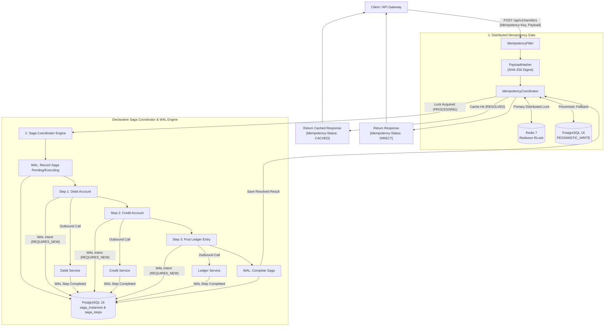

# DeltaFlow

> **Distributed Idempotency & Saga Orchestrator for Financial APIs**

[](https://openjdk.org/)
[](https://spring.io/projects/spring-boot)
[](https://www.postgresql.org/)
[](https://redis.io/)
[](LICENSE)

DeltaFlow is a high-consistency coordination proxy and transactional saga orchestrator engineered to guarantee **exactly-once execution** and **durable forward progression** for distributed payment processing and financial transfers.

---

## The Problem

Distributed financial systems and microservice architectures frequently encounter partial failures:
- **Duplicate Debits**: A payment request times out over the network while the debit succeeds remotely. An impatient client or automated gateway retries, double-charging the customer.
- **Payload Tampering / Key Collision**: A client reuses an `Idempotency-Key` but alters the payload (e.g. changing transaction amount or recipient account).
- **In-Flight Contention**: Rapid concurrent requests with the identical idempotency key arrive within milliseconds, creating race conditions across worker nodes.
- **Unrecorded Step Intent**: A service crashes while dispatching a payment step. Without a Write-Ahead Log (WAL), the system cannot determine if the outbound call was initiated.
- **Stranded States & Zombie Steps**: Worker processes crash mid-transaction, leaving distributed locks permanently orphaned.

DeltaFlow combines a high-speed distributed idempotency gate with a relational Write-Ahead Log (WAL) saga engine, providing deterministic multi-step transaction coordination with zero proprietary DSLs.

---

## Core Architecture



---

## Key Capabilities

1. **Relational Write-Ahead Log (WAL) Journaling**:
   - Every step's intent and request payload are durably committed to PostgreSQL (`Propagation.REQUIRES_NEW`) *prior* to outbound remote execution.
   - Preserves complete step execution records in `saga_steps` (request/response JSONB, timestamps, lease deadlines, failure details).

2. **Declarative Fluent Saga API**:
   - Define multi-step pipelines cleanly in type-safe Java code:
   ```java
   SagaDefinition<TransferRequestDto, TransferResponseDto> saga = SagaBuilder
           .<TransferRequestDto, TransferResponseDto>named("account-transfer")
           .step("debit-step")
               .action((ctx, req) -> debitService.debit(req.sourceAccountId(), req.amount(), ctx.getIdempotencyKey()))
               .compensate((ctx, req) -> debitService.compensateDebit(req.sourceAccountId(), req.amount(), ctx.getIdempotencyKey()))
           .step("credit-step")
               .action((ctx, req) -> creditService.credit(req.targetAccountId(), req.amount(), ctx.getIdempotencyKey()))
               .compensate((ctx, req) -> creditService.compensateCredit(req.targetAccountId(), req.amount(), ctx.getIdempotencyKey()))
           .step("ledger-step")
               .action((ctx, req) -> ledgerService.recordEntry(
                       ctx.getStepResult("debit-step", DebitResult.class).debitId(),
                       ctx.getStepResult("credit-step", CreditResult.class).creditId(),
                       req.amount(),
                       req.currency()
               ))
           .onCompletion((ctx, req) -> new TransferResponseDto(ctx.getSagaId(), "tx_" + ctx.getIdempotencyKey(), "COMPLETED", req.amount(), req.currency(), 3, Instant.now()))
           .build();
   ```

3. **Java 21 Sealed Lifecycle State Machines**:
   - Saga instances and individual steps transition through sealed hierarchies (`Pending`, `Executing`, `Completed`, `Failed`, `Compensating`).
   - Evaluated using compile-time exhaustive switch pattern matching with zero `default` catch-alls.

4. **Cryptographic Payload Tampering Protection**:
   - Incoming request payloads are hashed using SHA-256 digests.
   - Any reuse of an existing idempotency key with an altered payload is immediately rejected with `HTTP 409 Conflict (IDEMPOTENCY_KEY_PAYLOAD_MISMATCH)`.

5. **Tiered Distributed Locking**:
   - **Primary**: Redisson distributed locking on Redis 7 with sub-millisecond lease management.
   - **Failover**: Automatic fallback to PostgreSQL row-level pessimistic locking (`PESSIMISTIC_WRITE`).

6. **Immutable Context Flow**:
   - Downstream steps consume verified outputs from upstream steps through an immutable `SagaExecutionContext`.

7. **Structured Audit Trail**:
   - Emits immutable JSON audit log events (`SAGA_STARTED`, `STEP_EXECUTING`, `STEP_COMPLETED`, `SAGA_COMPLETED`, `STEP_FAILED`) for regulatory compliance (SOC2/PCI-DSS).

---

## Tech Stack

| Component | Technology | Description |
| :--- | :--- | :--- |
| **Language** | Java 21 LTS | Sealed Interfaces, Pattern Matching, Record Patterns |
| **Framework** | Spring Boot 3.3.5 | Spring Web, Spring Data JPA, Hibernate 6, Actuator |
| **Relational Storage** | PostgreSQL 16 | ACID persistence, `JSONB` journals, `PESSIMISTIC_WRITE` row locks, Flyway migrations |
| **Distributed Cache** | Redis 7 & Redisson | High-throughput distributed locks and TTL lease management |
| **Documentation** | Springdoc OpenAPI 2.6 | Interactive Swagger UI and OpenAPI 3.1 contract schemas |
| **Testing** | Testcontainers 1.20 | Containerized PostgreSQL 16 and Redis 7 test environments |

---

## Getting Started

### Prerequisites
- **Java 21** or higher
- **Maven 3.9+**
- **Docker** (for local dependencies and running integration tests)

### 1. Launch Infrastructure
Start PostgreSQL and Redis:

```bash
docker run -d --name deltaflow-postgres -e POSTGRES_DB=deltaflow -e POSTGRES_USER=postgres -e POSTGRES_PASSWORD=postgres -p 5432:5432 postgres:16-alpine
docker run -d --name deltaflow-redis -p 6379:6379 redis:7-alpine
```

### 2. Build and Run Application
```bash
mvn clean spring-boot:run
```

The service will start on `http://localhost:8080`.
- **OpenAPI Swagger UI**: `http://localhost:8080/swagger-ui.html`
- **OpenAPI Schema**: `http://localhost:8080/v3/api-docs`

---

## API Usage & Verification Scenarios

### Scenario 1: Execute 3-Step Account Transfer
Submit an account transfer with a client-generated `Idempotency-Key`:

```bash
curl -i -X POST http://localhost:8080/api/v1/transfers \
  -H "Content-Type: application/json" \
  -H "Idempotency-Key: xfer_demo_1001" \
  -d '{
    "sourceAccountId": "acc_1001",
    "targetAccountId": "acc_2002",
    "amount": 500.00,
    "currency": "USD"
  }'
```

**Response (`201 Created`, Direct Execution)**:
```http
HTTP/1.1 201 Created
Idempotency-Status: DIRECT
Content-Type: application/json

{
  "sagaId": "4a73e86f-5b6d-4ee8-809e-0129a089b031",
  "transactionId": "tx_xfer_demo_1001",
  "status": "COMPLETED",
  "amount": 500.00,
  "currency": "USD",
  "stepsCompleted": 3,
  "executedAt": "2026-11-10T06:45:00Z"
}
```

---

### Scenario 2: Identical Replay (Zero Downstream Execution)
Resend the identical request with the same `Idempotency-Key`:

```bash
curl -i -X POST http://localhost:8080/api/v1/transfers \
  -H "Content-Type: application/json" \
  -H "Idempotency-Key: xfer_demo_1001" \
  -d '{
    "sourceAccountId": "acc_1001",
    "targetAccountId": "acc_2002",
    "amount": 500.00,
    "currency": "USD"
  }'
```

**Response (`201 Created`, Served from Cache)**:
```http
HTTP/1.1 201 Created
Idempotency-Status: CACHED
Content-Type: application/json

{
  "sagaId": "4a73e86f-5b6d-4ee8-809e-0129a089b031",
  "transactionId": "tx_xfer_demo_1001",
  "status": "COMPLETED",
  "amount": 500.00,
  "currency": "USD",
  "stepsCompleted": 3,
  "executedAt": "2026-11-10T06:45:00Z"
}
```
*Returned in <10ms directly from cache with zero participant step executions.*

---

### Scenario 3: Payload Tampering Rejection
Submit a request using the same `Idempotency-Key` but an altered amount:

```bash
curl -i -X POST http://localhost:8080/api/v1/transfers \
  -H "Content-Type: application/json" \
  -H "Idempotency-Key: xfer_demo_1001" \
  -d '{
    "sourceAccountId": "acc_1001",
    "targetAccountId": "acc_2002",
    "amount": 9999.00,
    "currency": "USD"
  }'
```

**Response (`409 Conflict`)**:
```http
HTTP/1.1 409 Conflict
Content-Type: application/json

{
  "errorCode": "IDEMPOTENCY_KEY_PAYLOAD_MISMATCH",
  "message": "Payload SHA-256 digest does not match the original request for this idempotency key.",
  "idempotencyKey": "xfer_demo_1001"
}
```

---

### Scenario 4: Inspect WAL Journal Records
Inspect top-level saga status and detailed step journals:

```bash
# Get Saga Instance Details
curl -s http://localhost:8080/api/v1/sagas/4a73e86f-5b6d-4ee8-809e-0129a089b031

# Get Write-Ahead Log Step Records
curl -s http://localhost:8080/api/v1/sagas/4a73e86f-5b6d-4ee8-809e-0129a089b031/steps
```

---

## Testing

Run the test suite (requires Docker for Testcontainers):

```bash
mvn test
```

---

## License

Distributed under the Apache 2.0 License. See `LICENSE` for details.
