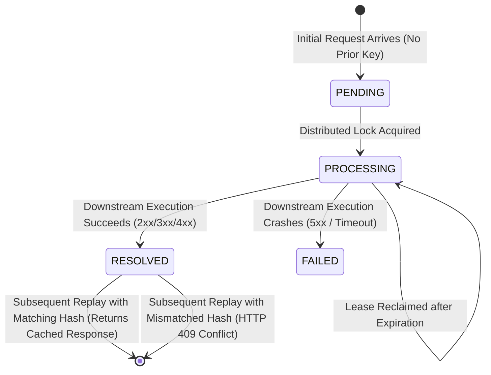

# Data Model: Milestone 1 - Foundations & Distributed Idempotency Gate

**Feature**: Milestone 1 - Foundations & Distributed Idempotency Gate  
**Branch**: `001-idempotency-gate`  
**Date**: 2026-11-08  
**Status**: Completed  

---

## 1. Relational Schema (PostgreSQL)

### Table: `idempotency_records`
Stores immutable request hashes, current lifecycle state, and cached terminal HTTP responses.

```sql
CREATE TABLE idempotency_records (
    tenant_id VARCHAR(64) NOT NULL DEFAULT 'default',
    idempotency_key VARCHAR(128) NOT NULL,
    request_hash CHAR(64) NOT NULL,
    status VARCHAR(20) NOT NULL,
    lock_token VARCHAR(64),
    response_status_code INT,
    response_headers JSONB,
    response_payload BYTEA,
    lease_expires_at TIMESTAMPTZ NOT NULL,
    created_at TIMESTAMPTZ NOT NULL DEFAULT CURRENT_TIMESTAMP,
    updated_at TIMESTAMPTZ NOT NULL DEFAULT CURRENT_TIMESTAMP,
    CONSTRAINT pk_idempotency_records PRIMARY KEY (tenant_id, idempotency_key)
);

CREATE INDEX idx_idempotency_lease_expiry 
    ON idempotency_records (status, lease_expires_at);

CREATE INDEX idx_idempotency_created_at 
    ON idempotency_records (created_at);
```

### Field Definitions

| Field | Type | Nullable | Description |
| :--- | :--- | :--- | :--- |
| `tenant_id` | `VARCHAR(64)` | No | Partition/tenant key for multi-tenant isolation. |
| `idempotency_key` | `VARCHAR(128)` | No | Client-supplied unique token from `Idempotency-Key` header. |
| `request_hash` | `CHAR(64)` | No | Lowercase hex string of SHA-256 digest of request body. |
| `status` | `VARCHAR(20)` | No | Lifecycle status: `PENDING`, `PROCESSING`, `RESOLVED`, `FAILED`. |
| `lock_token` | `VARCHAR(64)` | Yes | UUID of current lock owner (node/thread ID). Nullable when resolved. |
| `response_status_code` | `INT` | Yes | HTTP status code (e.g. 200, 201, 400). Populated when `RESOLVED`. |
| `response_headers` | `JSONB` | Yes | Serialized HTTP response headers (e.g. `{"Content-Type": "application/json"}`). |
| `response_payload` | `BYTEA` | Yes | Raw cached response body bytes. Populated when `RESOLVED`. |
| `lease_expires_at` | `TIMESTAMPTZ` | No | Expiration timestamp of the current active lease. |
| `created_at` | `TIMESTAMPTZ` | No | Record creation timestamp. |
| `updated_at` | `TIMESTAMPTZ` | No | Timestamp of the most recent state change. |

---

## 2. In-Memory Distributed Lock Schema (Redis)

### Key Structure: `deltaflow:lock:{tenantId}:{idempotencyKey}`
- **Type**: String / Redisson RLock
- **Value**: `{nodeId}:{threadId}:{lockToken}`
- **TTL**: 30 seconds (configurable via `deltaflow.idempotency.lease-ttl`)

### Key Structure: `deltaflow:channel:{tenantId}:{idempotencyKey}`
- **Type**: Redis Pub/Sub Channel
- **Purpose**: Broadcasts state transition events (`RESOLVED`, `FAILED`) to wake up concurrent contenders waiting on the same key without tight polling loops.

---

## 3. Java Domain Model (Java 21 Sealed Hierarchy)

### State Domain Modeling

```java
package io.deltaflow.idempotency.domain;

import java.time.Instant;
import java.util.Map;

public sealed interface IdempotencyState permits 
    IdempotencyState.Pending, 
    IdempotencyState.Processing, 
    IdempotencyState.Resolved, 
    IdempotencyState.Failed {

    record Pending(
        String tenantId, 
        String idempotencyKey, 
        String requestHash, 
        String lockToken, 
        Instant leaseExpiresAt
    ) implements IdempotencyState {}

    record Processing(
        String tenantId, 
        String idempotencyKey, 
        String requestHash, 
        String lockToken, 
        Instant leaseExpiresAt
    ) implements IdempotencyState {}

    record Resolved(
        String tenantId, 
        String idempotencyKey, 
        String requestHash, 
        int statusCode, 
        Map<String, String> headers, 
        byte[] payload, 
        Instant resolvedAt
    ) implements IdempotencyState {}

    record Failed(
        String tenantId, 
        String idempotencyKey, 
        String requestHash, 
        String failureReason, 
        Instant failedAt
    ) implements IdempotencyState {}
}
```

### Lock Acquisition Result

```java
package io.deltaflow.idempotency.domain;

public sealed interface LockAcquisitionResult permits 
    LockAcquisitionResult.Acquired,
    LockAcquisitionResult.Replayed,
    LockAcquisitionResult.PayloadMismatch,
    LockAcquisitionResult.ConcurrentConflict {

    record Acquired(String lockToken) implements LockAcquisitionResult {}
    record Replayed(IdempotencyState.Resolved resolved) implements LockAcquisitionResult {}
    record PayloadMismatch(String existingHash, String incomingHash) implements LockAcquisitionResult {}
    record ConcurrentConflict(String idempotencyKey, IdempotencyState state) implements LockAcquisitionResult {}
}
```

---

## 4. State Transition Matrix



### Transition Validation Rules

1. **Non-Existent $\rightarrow$ PENDING**:
   - Condition: Key does not exist in store.
   - Action: Insert with `status = PENDING`, compute `request_hash`, assign initial lease (`now + leaseTTL`).
2. **PENDING $\rightarrow$ PROCESSING**:
   - Condition: Redis/Postgres lock granted to thread.
   - Action: Assign `lock_token`, update `status = PROCESSING`.
3. **PROCESSING $\rightarrow$ RESOLVED**:
   - Condition: Downstream handler returns terminal response without unhandled crash.
   - Action: Persist `response_status_code`, `response_headers`, `response_payload`. Update `status = RESOLVED`, clear `lock_token`. Publish event to Redis channel.
4. **PROCESSING $\rightarrow$ FAILED**:
   - Condition: Downstream execution encounters unrecoverable failure.
   - Action: Update `status = FAILED`, release lock token, publish event to channel.
5. **Re-Acquisition / Lease Expiration**:
   - Condition: Status is `PROCESSING` or `PENDING` AND `lease_expires_at < CURRENT_TIMESTAMP`.
   - Action: Overwrite `lock_token`, advance `lease_expires_at = now + leaseTTL`, log `LEASE_EXPIRED_RECLAIMED`.

