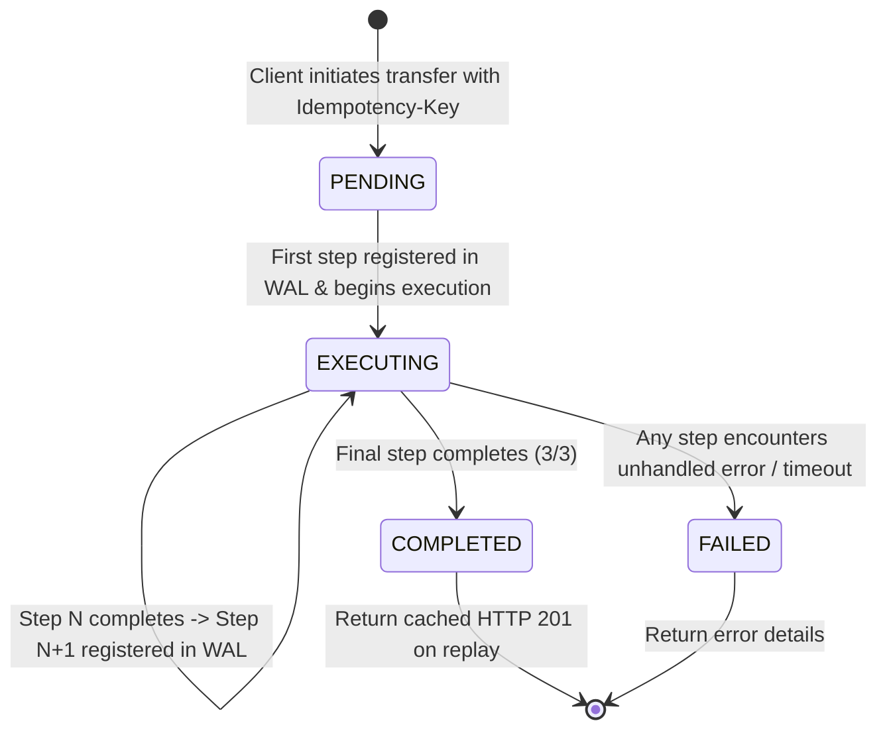

# Data Model: Milestone 2 - Declarative Saga Coordinator & WAL Engine

**Feature**: Milestone 2 - Declarative Saga Coordinator & WAL Engine (Forward Path)  
**Branch**: `002-saga-coordinator`  
**Date**: 2026-11-10  
**Status**: Completed  

---

## 1. Relational Schema (PostgreSQL)

### Table: `saga_instances`
Stores top-level saga executions, lifecycle states, input payloads, and terminal results.

```sql
CREATE TABLE saga_instances (
    saga_id UUID PRIMARY KEY,
    tenant_id VARCHAR(64) NOT NULL DEFAULT 'default',
    idempotency_key VARCHAR(128) NOT NULL,
    saga_type VARCHAR(64) NOT NULL,
    status VARCHAR(32) NOT NULL,
    current_step INT NOT NULL DEFAULT 0,
    payload JSONB NOT NULL,
    result_payload JSONB,
    created_at TIMESTAMPTZ NOT NULL DEFAULT CURRENT_TIMESTAMP,
    updated_at TIMESTAMPTZ NOT NULL DEFAULT CURRENT_TIMESTAMP,
    CONSTRAINT uq_saga_tenant_idempotency UNIQUE (tenant_id, idempotency_key)
);

CREATE INDEX idx_saga_instances_status 
    ON saga_instances (status);

CREATE INDEX idx_saga_instances_tenant_key 
    ON saga_instances (tenant_id, idempotency_key);
```

### Table: `saga_steps`
Stores Write-Ahead Log (WAL) journals for each step within a saga, recording request payloads before execution and response payloads upon completion.

```sql
CREATE TABLE saga_steps (
    step_id UUID PRIMARY KEY,
    saga_id UUID NOT NULL REFERENCES saga_instances(saga_id) ON DELETE CASCADE,
    step_name VARCHAR(64) NOT NULL,
    step_index INT NOT NULL,
    status VARCHAR(32) NOT NULL,
    request_payload JSONB,
    response_payload JSONB,
    error_details TEXT,
    lease_expires_at TIMESTAMPTZ,
    created_at TIMESTAMPTZ NOT NULL DEFAULT CURRENT_TIMESTAMP,
    updated_at TIMESTAMPTZ NOT NULL DEFAULT CURRENT_TIMESTAMP,
    CONSTRAINT uq_saga_step_index UNIQUE (saga_id, step_index)
);

CREATE INDEX idx_saga_steps_saga_status 
    ON saga_steps (saga_id, status);

CREATE INDEX idx_saga_steps_lease 
    ON saga_steps (status, lease_expires_at);
```

---

## 2. Field Definitions

### `saga_instances`

| Field | Type | Nullable | Description |
| :--- | :--- | :--- | :--- |
| `saga_id` | `UUID` | No | Globally unique identifier for this saga instance. |
| `tenant_id` | `VARCHAR(64)` | No | Multi-tenant partition key (defaults to `'default'`). |
| `idempotency_key` | `VARCHAR(128)` | No | Client-provided token linking to the Idempotency Gate. |
| `saga_type` | `VARCHAR(64)` | No | Identifier for the workflow schema (e.g. `ACCOUNT_TRANSFER`). |
| `status` | `VARCHAR(32)` | No | Lifecycle status: `PENDING`, `EXECUTING`, `COMPLETED`, `FAILED`, `COMPENSATING`. |
| `current_step` | `INT` | No | Zero-based index of the active or latest step. |
| `payload` | `JSONB` | No | Serialized initial input parameters. |
| `result_payload` | `JSONB` | Yes | Serialized final terminal outcome upon completion. |
| `created_at` | `TIMESTAMPTZ` | No | Creation timestamp. |
| `updated_at` | `TIMESTAMPTZ` | No | Timestamp of the most recent state change. |

### `saga_steps`

| Field | Type | Nullable | Description |
| :--- | :--- | :--- | :--- |
| `step_id` | `UUID` | No | Unique identifier for this step execution journal. |
| `saga_id` | `UUID` | No | Foreign key referencing `saga_instances.saga_id`. |
| `step_name` | `VARCHAR(64)` | No | Identifier for the step (e.g. `debit-source-account`). |
| `step_index` | `INT` | No | Sequence index in the execution order (0, 1, 2, ...). |
| `status` | `VARCHAR(32)` | No | Step status: `NOT_STARTED`, `EXECUTING`, `COMPLETED`, `FAILED`, `COMPENSATED`. |
| `request_payload` | `JSONB` | Yes | Outbound payload written prior to network call. |
| `response_payload` | `JSONB` | Yes | Inbound response written upon return from participant. |
| `error_details` | `TEXT` | Yes | Exception message or error diagnostic on failure. |
| `lease_expires_at` | `TIMESTAMPTZ` | Yes | Lease deadline for zombie detection / recovery. |
| `created_at` | `TIMESTAMPTZ` | No | Record creation timestamp. |
| `updated_at` | `TIMESTAMPTZ` | No | Most recent status update timestamp. |

---

## 3. Java 21 Sealed Domain Hierarchy

### Saga Lifecycle Hierarchy (`SagaState.java`)

```java
package io.deltaflow.saga.domain;

import java.time.Instant;
import java.util.Map;
import java.util.UUID;

public sealed interface SagaState permits 
    SagaState.Pending, 
    SagaState.Executing, 
    SagaState.Completed, 
    SagaState.Failed, 
    SagaState.Compensating {

    record Pending(
        UUID sagaId, 
        String tenantId, 
        String idempotencyKey, 
        String sagaType, 
        Map<String, Object> payload, 
        Instant createdAt
    ) implements SagaState {}

    record Executing(
        UUID sagaId, 
        String tenantId, 
        int currentStepIndex, 
        String currentStepName, 
        Instant stepStartedAt
    ) implements SagaState {}

    record Completed(
        UUID sagaId, 
        String tenantId, 
        Map<String, Object> finalResult, 
        Instant completedAt
    ) implements SagaState {}

    record Failed(
        UUID sagaId, 
        String tenantId, 
        int failedStepIndex, 
        String failureReason, 
        Instant failedAt
    ) implements SagaState {}

    record Compensating(
        UUID sagaId, 
        String tenantId, 
        int rollbackStepIndex, 
        String cause
    ) implements SagaState {}
}
```

### Saga Step Lifecycle Hierarchy (`SagaStepState.java`)

```java
package io.deltaflow.saga.domain;

import java.time.Instant;
import java.util.Map;
import java.util.UUID;

public sealed interface SagaStepState permits 
    SagaStepState.NotStarted, 
    SagaStepState.Executing, 
    SagaStepState.Completed, 
    SagaStepState.Failed, 
    SagaStepState.Compensated {

    record NotStarted(UUID stepId, int stepIndex, String stepName) implements SagaStepState {}
    record Executing(UUID stepId, int stepIndex, String stepName, Map<String, Object> requestPayload, Instant startedAt) implements SagaStepState {}
    record Completed(UUID stepId, int stepIndex, String stepName, Map<String, Object> responsePayload, Instant completedAt) implements SagaStepState {}
    record Failed(UUID stepId, int stepIndex, String stepName, String errorDetails, Instant failedAt) implements SagaStepState {}
    record Compensated(UUID stepId, int stepIndex, String stepName, Instant compensatedAt) implements SagaStepState {}
}
```

---

## 4. State Transition Matrix



### Step-Level WAL Lifecycle

```mermaid
sequenceDiagram
    autonumber
    participant Client
    participant Coordinator as Saga Coordinator
    participant WAL as PostgreSQL (WAL Journal)
    participant Participant as Downstream Service (Debit/Credit/Ledger)

    Client->>Coordinator: Initiate Transfer
    Coordinator->>WAL: INSERT saga_instances (PENDING)
    loop For each Step (Debit -> Credit -> Ledger)
        Coordinator->>WAL: INSERT/UPDATE saga_steps (EXECUTING, request_payload)
        Note over Coordinator,WAL: Committed to DB before network call!
        Coordinator->>Participant: Remote HTTP Call
        Participant-->>Coordinator: Response OK
        Coordinator->>WAL: UPDATE saga_steps (COMPLETED, response_payload)
    end
    Coordinator->>WAL: UPDATE saga_instances (COMPLETED, result_payload)
    Coordinator-->>Client: HTTP 201 Created
```

---

## 5. Invariant Validation Rules

1. **WAL Invariant**: No remote call may be dispatched unless `saga_steps` contains a committed row with `status = 'EXECUTING'` and the outbound payload.
2. **Sequential Invariant**: Step $N$ cannot start until Step $N-1$ has `status = 'COMPLETED'`.
3. **Idempotency Guarantee**: If a saga already exists for `(tenant_id, idempotency_key)`:
   - If `COMPLETED`: return cached `result_payload` immediately.
   - If `EXECUTING`: wait up to contender timeout or return HTTP 409 Conflict.
4. **Compile-Time Exhaustion**: All state transition evaluations must use pattern matching over `SagaState` and `SagaStepState` without default branches.

