# Tasks: Milestone 2 - Declarative Saga Coordinator & WAL Engine (Forward Path)

**Input**: Design documents from `/specs/002-saga-coordinator/`  
**Prerequisites**: [plan.md](plan.md), [spec.md](spec.md), [data-model.md](data-model.md), [contracts/saga-api.yaml](contracts/saga-api.yaml), [research.md](research.md), [quickstart.md](quickstart.md)  
**Constitution Alignment**: Constitution Principles I (Zero Double-Spend & WAL), II (Monotonic Fencing), III (Java 21 Sealed Exhaustion), IV (Testcontainers TDD), V (Immutable Audit Logs).

---

## Format: `[ID] [P?] [Story] Description`

- **[P]**: Can run in parallel (independent files, no direct dependencies)
- **[Story]**: Maps task directly to user story (`US1`, `US2`, `US3`, `US4`)
- Exact file paths are explicitly specified for every task

---

## Phase 1: Setup (Database Schema & Packaging)

**Purpose**: Database schema creation and directory initialization for Milestone 2.

- [ ] T001 Create Flyway migration script `V2__create_saga_tables.sql` in `src/main/resources/db/migration/V2__create_saga_tables.sql` defining `saga_instances` and `saga_steps` tables with indexes and unique constraints.
- [ ] T002 [P] Establish package hierarchy `io.deltaflow.saga` (`domain`, `repository`, `builder`, `service`, `demo`, `api`, `dto`).

---

## Phase 2: Foundational (Domain Entities, Sealed States & Repositories)

**Purpose**: Core domain models and persistence prerequisites required across all user stories.

**⚠️ CRITICAL**: Must be completed before user story execution begins.

- [ ] T003 [P] Implement Java 21 sealed interface `SagaState` and records (`Pending`, `Executing`, `Completed`, `Failed`, `Compensating`) in `src/main/java/io/deltaflow/saga/domain/SagaState.java`.
- [ ] T004 [P] Implement Java 21 sealed interface `SagaStepState` and records (`NotStarted`, `Executing`, `Completed`, `Failed`, `Compensated`) in `src/main/java/io/deltaflow/saga/domain/SagaStepState.java`.
- [ ] T005 [P] Implement `SagaInstance` JPA Entity in `src/main/java/io/deltaflow/saga/domain/SagaInstance.java` with `@JdbcTypeCode(SqlTypes.JSON)` for JSONB payload columns.
- [ ] T006 [P] Implement `SagaStep` JPA Entity in `src/main/java/io/deltaflow/saga/domain/SagaStep.java` with `@JdbcTypeCode(SqlTypes.JSON)` for request and response payloads.
- [ ] T007 Implement `SagaInstanceRepository` in `src/main/java/io/deltaflow/saga/repository/SagaInstanceRepository.java` with `@Lock(LockModeType.PESSIMISTIC_WRITE)` for tenant/idempotency-key lookup.
- [ ] T008 [P] Implement `SagaStepRepository` in `src/main/java/io/deltaflow/saga/repository/SagaStepRepository.java` supporting ordered retrieval by saga ID and step index.
- [ ] T009 [P] Implement immutable `SagaExecutionContext` in `src/main/java/io/deltaflow/saga/domain/SagaExecutionContext.java` providing step outputs map and execution metadata.

**Checkpoint**: Foundational entities and repositories ready for pipeline builder and journal store.

---

## Phase 3: User Story 4 - Declarative Saga Definition Builder (Priority: P3)

**Goal**: Enable declarative, type-safe definition of multi-step sagas via a fluent Java 21 API.

**Independent Test**: Verified via unit tests asserting that steps, actions, compensations, and context transformations build correctly without runtime reflection.

### Tests for User Story 4

- [ ] T010 [P] [US4] Write unit tests for fluent saga definition in `src/test/java/io/deltaflow/saga/builder/SagaBuilderTest.java`.

### Implementation for User Story 4

- [ ] T011 [P] [US4] Implement `SagaStepDefinition` functional record in `src/main/java/io/deltaflow/saga/builder/SagaStepDefinition.java`.
- [ ] T012 [P] [US4] Implement `SagaDefinition` contract in `src/main/java/io/deltaflow/saga/builder/SagaDefinition.java`.
- [ ] T013 [US4] Implement `SagaBuilder` fluent builder in `src/main/java/io/deltaflow/saga/builder/SagaBuilder.java` supporting `.step(name).action(...).compensate(...)`.

**Checkpoint**: Sagas can be defined declaratively in Java code.

---

## Phase 4: User Story 2 - Write-Ahead Log (WAL) Journal Store (Priority: P1)

**Goal**: Guarantee that every step's intent and payload is durably committed to PostgreSQL *before* outbound remote invocation (Constitution Principle I).

**Independent Test**: Integration test verifying that a step record with status `EXECUTING` is committed to PostgreSQL before downstream service receives the call.

### Tests for User Story 2

- [ ] T014 [P] [US2] Write integration test in `src/test/java/io/deltaflow/saga/integration/SagaWalPersistenceIntegrationTest.java` verifying pre-dispatch WAL persistence in PostgreSQL using Testcontainers.

### Implementation for User Story 2

- [ ] T015 [US2] Implement `SagaJournalStore` in `src/main/java/io/deltaflow/saga/service/SagaJournalStore.java` using `@Transactional(propagation = Propagation.REQUIRES_NEW)` to record step intent before external call and step completion after reply.
- [ ] T016 [US2] Wire structured audit logging (`STEP_EXECUTING`, `STEP_COMPLETED`) into `SagaJournalStore` using `AuditLogger`.

**Checkpoint**: Write-Ahead Log persistence is durably committed prior to any network dispatch.

---

## Phase 5: User Story 1 - Happy-Path 3-Step Forward Saga Execution (Priority: P1) 🎯 MVP

**Goal**: Coordinate sequential execution of a 3-step account transfer (Debit $\rightarrow$ Credit $\rightarrow$ Ledger) with forward progression and state durability.

**Independent Test**: Submit a transfer request for $500.00 and verify all 3 steps execute in order, commit journal entries, and return HTTP 201 with final transaction details.

### Tests for User Story 1

- [ ] T017 [P] [US1] Write end-to-end integration test in `src/test/java/io/deltaflow/saga/integration/SagaForwardExecutionIntegrationTest.java` verifying 3-step forward pipeline execution.

### Implementation for User Story 1

- [ ] T018 [P] [US1] Implement demo participant services (`DebitService`, `CreditService`, `LedgerService`) in `src/main/java/io/deltaflow/saga/demo/service/`.
- [ ] T019 [US1] Implement `SagaCoordinator` in `src/main/java/io/deltaflow/saga/service/SagaCoordinator.java` executing steps sequentially, advancing `SagaState`, and integrating with `SagaJournalStore`.
- [ ] T020 [US1] Implement `TransferSagaConfig` in `src/main/java/io/deltaflow/saga/demo/TransferSagaConfig.java` registering the reference 3-step `account-transfer` saga bean.
- [ ] T021 [P] [US1] Implement request/response DTOs (`TransferRequestDto`, `TransferResponseDto`, `SagaInstanceDto`, `SagaStepDto`) in `src/main/java/io/deltaflow/saga/api/dto/`.
- [ ] T022 [US1] Implement `TransferController` in `src/main/java/io/deltaflow/saga/api/TransferController.java` exposing `POST /api/v1/transfers`.

**Checkpoint**: End-to-end 3-step money transfer saga executes and commits successfully.

---

## Phase 6: User Story 3 - Idempotency Gate Integration & Deduping (Priority: P2)

**Goal**: Prevent duplicate saga initiations or double-transfers by wiring the Idempotency Gate from Milestone 1 to the Saga Coordinator.

**Independent Test**: Send identical requests with the same `Idempotency-Key` and verify the second request returns the cached terminal response with `Idempotency-Status: CACHED` and 0 additional downstream executions.

### Tests for User Story 3

- [ ] T023 [P] [US3] Write integration test in `src/test/java/io/deltaflow/saga/integration/SagaIdempotentReplayIntegrationTest.java` verifying cache replay and tampering detection on transfer endpoints.

### Implementation for User Story 3

- [ ] T024 [US3] Connect `TransferController` with `IdempotencyCoordinator` (Milestone 1) to verify request hash, handle lock tokens, and cache final HTTP response.
- [ ] T025 [P] [US3] Implement `SagaInspectorController` in `src/main/java/io/deltaflow/saga/api/SagaInspectorController.java` exposing `GET /api/v1/sagas/{sagaId}` and `GET /api/v1/sagas/{sagaId}/steps`.

**Checkpoint**: Sagas are strictly idempotent; duplicate requests return cached responses without re-executing steps.

---

## Phase 7: Polish & Cross-Cutting Concerns

**Purpose**: Verification, documentation, and regression testing.

- [ ] T026 [P] Add OpenAPI 3.1 documentation annotations on `TransferController` and `SagaInspectorController`.
- [ ] T027 Run full test suite (`mvn test -B`) verifying all Milestone 1 idempotency tests + new Milestone 2 saga integration tests pass cleanly.
- [ ] T028 Validate quickstart walkthrough scenarios from `specs/002-saga-coordinator/quickstart.md`.

---

## Dependencies & Execution Order

```mermaid
graph TD
    T001[T001: Flyway V2 Migration] --> T005[T005: SagaInstance Entity]
    T001 --> T006[T006: SagaStep Entity]
    T002[T002: Package Hierarchy] --> T003[T003: SagaState Sealed Hierarchy]
    T002 --> T004[T004: SagaStepState Sealed Hierarchy]
    T005 --> T007[T007: SagaInstanceRepository]
    T006 --> T008[T008: SagaStepRepository]
    T003 & T004 --> T009[T009: SagaExecutionContext]
    
    %% US4: Builder
    T009 --> T011[T011: SagaStepDefinition]
    T011 --> T012[T012: SagaDefinition]
    T010[T010: SagaBuilderTest] --> T013[T013: SagaBuilder]
    T012 --> T013
    
    %% US2: WAL Journal Store
    T007 & T008 --> T015[T015: SagaJournalStore]
    T014[T014: SagaWalPersistenceIntegrationTest] --> T015
    T015 --> T016[T016: Audit Logging in JournalStore]
    
    %% US1: Forward Execution MVP
    T013 & T015 --> T019[T019: SagaCoordinator]
    T018[T018: Debit/Credit/Ledger Services] --> T020[T020: TransferSagaConfig]
    T019 & T020 --> T022[T022: TransferController]
    T017[T017: SagaForwardExecutionIntegrationTest] --> T022
    T021[T021: API DTOs] --> T022
    
    %% US3: Idempotency Gate
    T022 --> T024[T024: Wire IdempotencyCoordinator]
    T023[T023: SagaIdempotentReplayIntegrationTest] --> T024
    T007 & T008 --> T025[T025: SagaInspectorController]
    
    %% Polish
    T024 & T025 --> T026[T026: OpenAPI Docs]
    T026 --> T027[T027: Full Test Suite Run]
    T027 --> T028[T028: Quickstart Validation]
```

---

## Implementation Strategy: MVP First

1. **Step 1 (Foundational)**: Run Flyway migration `V2` and implement sealed records (`SagaState`, `SagaStepState`) + JPA repositories.
2. **Step 2 (WAL Store)**: Implement `SagaJournalStore` committing step records in independent transactions (`Propagation.REQUIRES_NEW`).
3. **Step 3 (MVP)**: Implement `SagaBuilder`, `SagaCoordinator`, demo services, and verify 3-step forward execution with `SagaForwardExecutionIntegrationTest`.
4. **Step 4 (Idempotency)**: Connect `TransferController` to `IdempotencyCoordinator` and verify zero double-spend with `SagaIdempotentReplayIntegrationTest`.
5. **Step 5 (Verification)**: Run full test suite with Testcontainers (`mvn test -B`).

