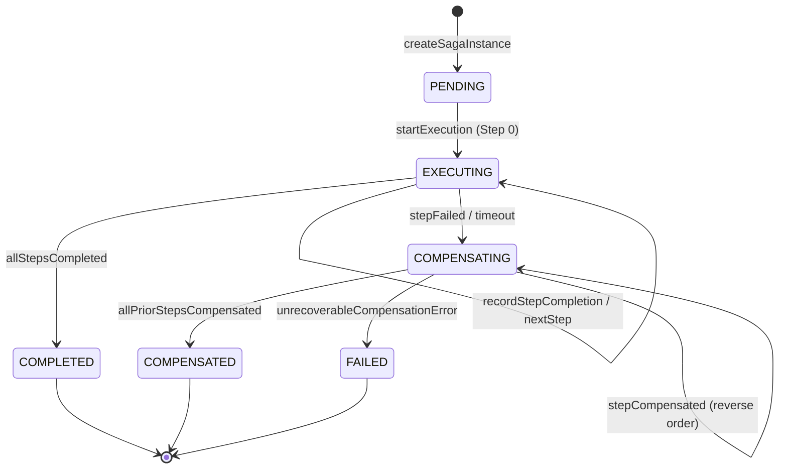
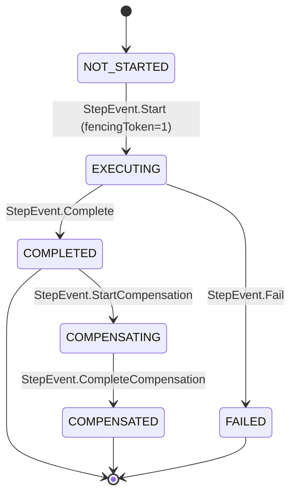

# Data Model: Backward Compensation, Crash Recovery & Zombie Fencing

## Relational Schema Changes

DeltaFlow extends the PostgreSQL Write-Ahead Log (WAL) schema established in Milestone 2 to support monotonic fencing tokens and indexed recovery scanning.

### Migration: `V2__add_fencing_token_to_saga_steps.sql`

```sql
-- Add monotonic fencing token for zombie rejection
ALTER TABLE saga_steps 
    ADD COLUMN fencing_token BIGINT NOT NULL DEFAULT 1;

-- Optimized index for recovery scanner polling expired in-flight sagas
CREATE INDEX idx_saga_instances_recovery 
    ON saga_instances (status, updated_at)
    WHERE status IN ('EXECUTING', 'COMPENSATING');

-- Index for fencing token lookups
CREATE INDEX idx_saga_steps_fencing 
    ON saga_steps (saga_id, step_index, fencing_token);
```

---

## Entity Definitions

### 1. `SagaInstance` (`saga_instances`)

Represents the overall lifecycle of a distributed multi-service transaction.

| Column | Type | Constraints | Description |
|--------|------|-------------|-------------|
| `saga_id` | UUID | PK, NOT NULL | Globally unique saga identifier |
| `tenant_id` | VARCHAR(64) | NOT NULL, DEFAULT 'default' | Multi-tenant namespace |
| `idempotency_key` | VARCHAR(128) | NOT NULL | Client-supplied idempotency key |
| `saga_type` | VARCHAR(64) | NOT NULL | Workflow name (e.g., `ACCOUNT_TRANSFER`) |
| `status` | VARCHAR(32) | NOT NULL | Current state (see State Transitions below) |
| `current_step` | INT | NOT NULL, DEFAULT 0 | Index of the active or failed step |
| `payload` | JSONB | NOT NULL | Initial input payload |
| `result_payload` | JSONB | NULL | Final completed or compensated result |
| `created_at` | TIMESTAMPTZ | NOT NULL, DEFAULT CURRENT_TIMESTAMP | Creation timestamp |
| `updated_at` | TIMESTAMPTZ | NOT NULL, DEFAULT CURRENT_TIMESTAMP | Last transition timestamp (used for lease recovery) |

#### Lifecycle State Transitions (`SagaState`)



- **Compile-Time Exhaustive States (`SagaState`)**:
  - `SagaState.Pending(UUID sagaId, String tenantId, String idempotencyKey, String sagaType, Map<String, Object> payload, Instant createdAt)`
  - `SagaState.Executing(UUID sagaId, String tenantId, int currentStepIndex, String currentStepName, Instant stepStartedAt)`
  - `SagaState.Completed(UUID sagaId, String tenantId, Map<String, Object> finalResult, Instant completedAt)`
  - `SagaState.Compensating(UUID sagaId, String tenantId, int rollbackStepIndex, String cause)`
  - `SagaState.Compensated(UUID sagaId, String tenantId, Map<String, Object> compensationResult, Instant compensatedAt)`
  - `SagaState.Failed(UUID sagaId, String tenantId, int failedStepIndex, String failureReason, Instant failedAt)`

---

### 2. `SagaStep` (`saga_steps`)

Represents each discrete forward and backward step recorded in the write-ahead journal.

| Column | Type | Constraints | Description |
|--------|------|-------------|-------------|
| `step_id` | UUID | PK, NOT NULL | Step row identifier |
| `saga_id` | UUID | FK -> `saga_instances(saga_id)`, NOT NULL | Parent saga reference |
| `step_name` | VARCHAR(64) | NOT NULL | Name of the step (e.g., `debit-step`) |
| `step_index` | INT | NOT NULL | Sequential 0-based position in pipeline |
| `status` | VARCHAR(32) | NOT NULL | Step state: `EXECUTING`, `COMPLETED`, `FAILED`, `COMPENSATING`, `COMPENSATED` |
| `fencing_token` | BIGINT | NOT NULL, DEFAULT 1 | Monotonically incrementing execution epoch |
| `request_payload` | JSONB | NULL | Payload sent to forward action or compensation |
| `response_payload`| JSONB | NULL | Output received from forward action or compensation |
| `error_details` | TEXT | NULL | Captured exception message or failure diagnostics |
| `lease_expires_at`| TIMESTAMPTZ | NULL | Expiration timestamp for active step execution |
| `created_at` | TIMESTAMPTZ | NOT NULL, DEFAULT CURRENT_TIMESTAMP | Creation timestamp |
| `updated_at` | TIMESTAMPTZ | NOT NULL, DEFAULT CURRENT_TIMESTAMP | Last modification timestamp |

#### Step State Transitions (`SagaStepState`)



- **Compile-Time Exhaustive Step States (`SagaStepState`)**:
  - `SagaStepState.NotStarted(UUID stepId, int stepIndex, String stepName)`
  - `SagaStepState.Executing(UUID stepId, int stepIndex, String stepName, long fencingToken, Map<String, Object> requestPayload, Instant startedAt)`
  - `SagaStepState.Completed(UUID stepId, int stepIndex, String stepName, long fencingToken, Map<String, Object> responsePayload, Instant completedAt)`
  - `SagaStepState.Failed(UUID stepId, int stepIndex, String stepName, long fencingToken, String errorDetails, Instant failedAt)`
  - `SagaStepState.Compensating(UUID stepId, int stepIndex, String stepName, long fencingToken, Instant startedAt)`
  - `SagaStepState.Compensated(UUID stepId, int stepIndex, String stepName, long fencingToken, Instant compensatedAt)`

---

## Fencing Token Invariants

1. **Monotonicity**: `fencing_token` for any step $i$ strictly increases upon each dispatch attempt: `token_{n+1} = token_n + 1`.
2. **Rejection Rule**: If a response arrives with token $T_{resp}$ where $T_{resp} < T_{current}$, or if the saga status $\in \{\text{COMPENSATING}, \text{COMPENSATED}\}$, the response MUST be dropped with zero state modifications.
3. **Audit Log Verification**: Every rejected zombie step emits structured log event `ZOMBIE_STEP_REJECTED` with details `{"staleToken": T_resp, "activeToken": T_current, "stepName": stepName}`.

